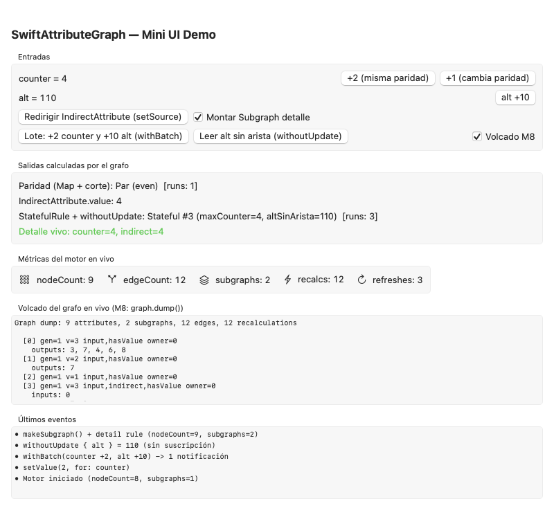

# MiniUIApp

Mini aplicación de demostración en macOS (`AppKit` + `SwiftUI` + `SwiftAttributeGraph`) que muestra en tiempo real:

- Evaluación perezosa y corte por versión (`Map` + `parityRuns`).
- Redirección dinámica de `IndirectAttribute` (`setSource`).
- Ciclo de vida de un `Subgraph` montado/desmontado leído con `WeakAttribute`.
- Métricas en vivo del motor (`nodeCount`, `edgeCount`, `liveSubgraphCount`, `recalculationCount`).



## Cómo ejecutarla

```bash
# Abrir la ventana interactiva en macOS:
swift run --package-path Examples/MiniUIApp

# Ejecutar la suite automatizada (verifica contadores, teardown de subgrafos y batches):
swift test --package-path Examples/MiniUIApp

# Verificar el flujo completo por línea de comandos (debug o release):
swift run --package-path Examples/MiniUIApp MiniUIApp --verify

# Medir latencia por interacción en release (mediana de 9 rondas x 1000 ops) y ratio de refresco:
swift run -c release --package-path Examples/MiniUIApp MiniUIApp --bench

# Comparar ejecuciones reales de `body` en SwiftUI (`@Observable` nativo vs `SwiftAttributeGraph`):
swift run --package-path Examples/MiniUIApp MiniUIApp --parity

# Renderizar una captura PNG fuera de pantalla:
swift run --package-path Examples/MiniUIApp MiniUIApp --snapshot /tmp/miniui-preview.png
```
